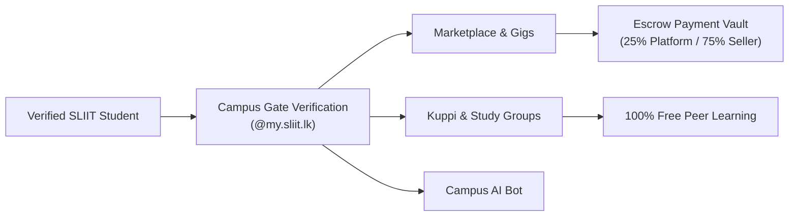
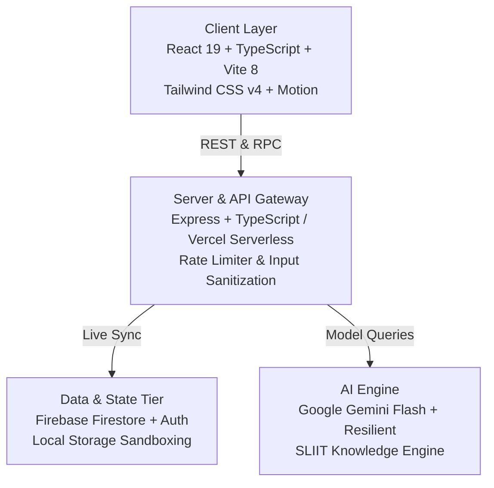
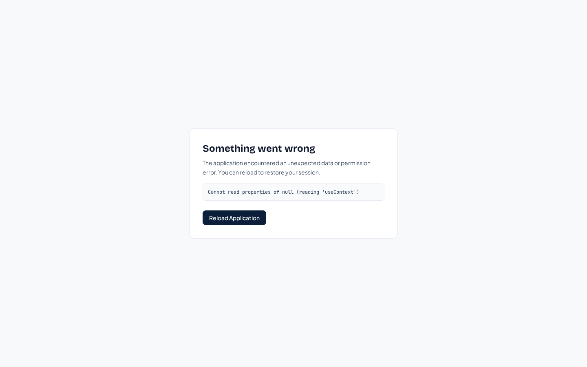
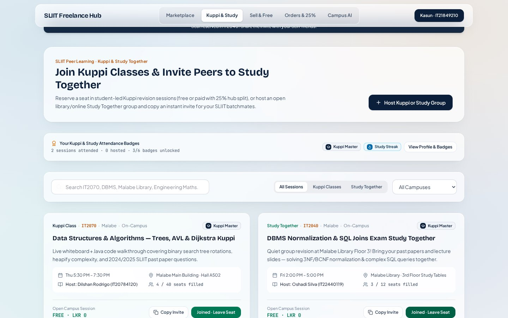
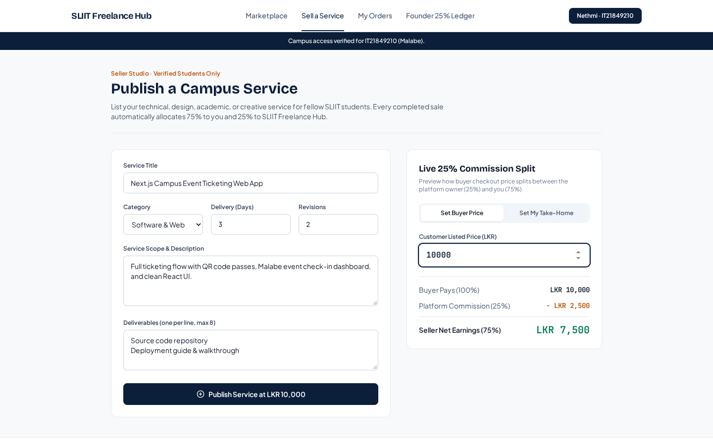
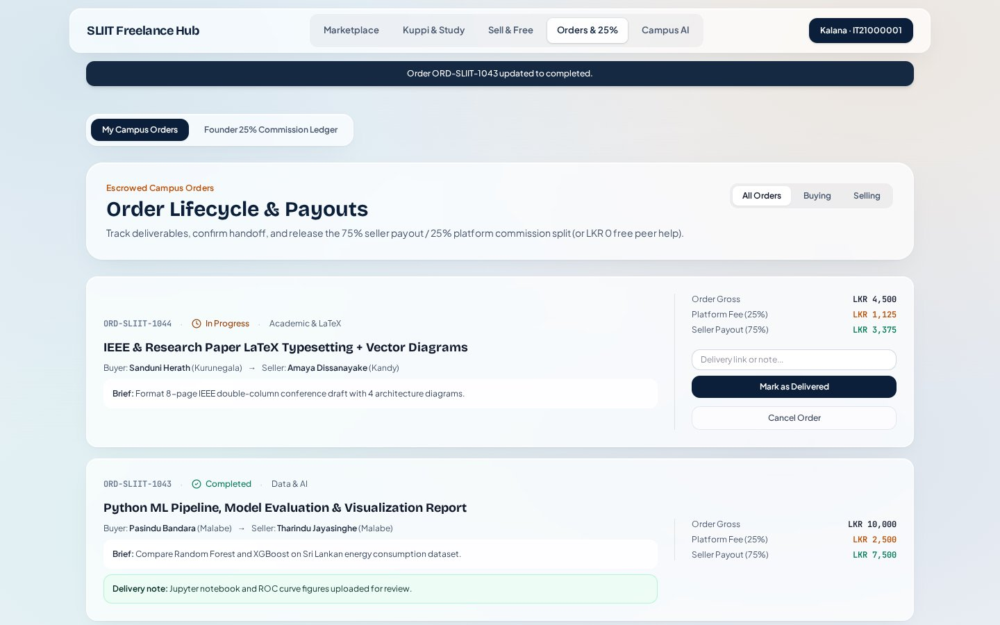
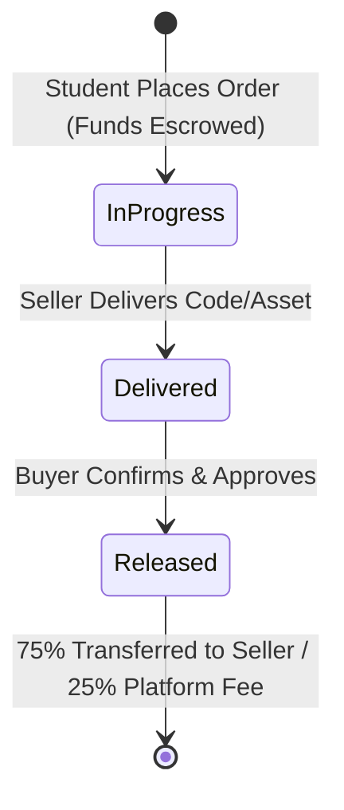
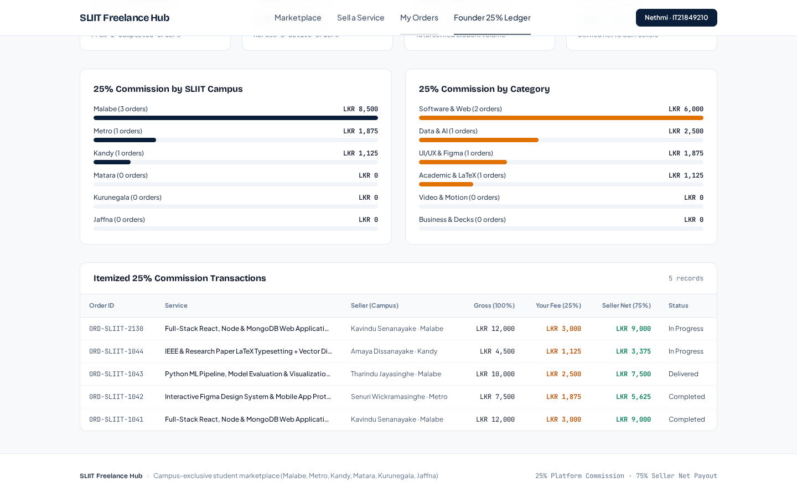
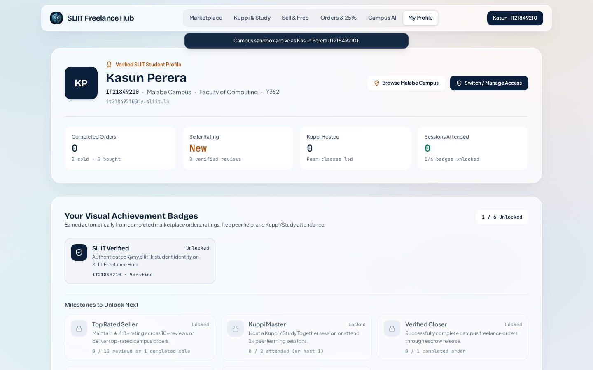
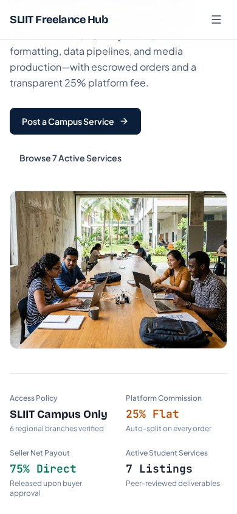

# 🎓 SLIIT Freelance Hub & Campus AI Ecosystem
### Comprehensive Project Documentation & Evaluation Report
**Prepared for Academic Presentation & Project Evaluation**  
**Project Team:** The team Vanguard  
**Copyright:** © 2026 The team Vanguard. All Rights Reserved.  
**Live Repository:** [GitHub - SLIIT-Freelance](https://github.com/pasalindumethsara5-hash/SLIIT-Freelance)

---

## 1. Executive Summary

The **SLIIT Freelance Hub** is an institutionalized, campus-exclusive freelance marketplace and academic peer-support ecosystem built specifically for students of the **Sri Lanka Institute of Information Technology (SLIIT)** across Malabe, Metropolitan (Colombo 03), Kandy, Matara, Kurunegala, and Jaffna campuses.

The platform resolves three critical challenges faced by university students:
1. **Unregulated Peer Services:** Students regularly seek and provide tech, design, and academic support via unofficial messaging groups without payment security or quality assurance.
2. **Academic Support Fragmentation:** Senior-to-junior revision classes (**Kuppi**) lack centralized scheduling, discovery, and attendance verification.
3. **Escrow & Trust Deficit:** Lack of escrow payment mechanisms exposes students to non-payment or incomplete project deliveries.

**SLIIT Freelance Hub** addresses these problems through:
- **Campus-Gated Access:** Enforced official `@my.sliit.lk` / `@sliit.lk` email validation and SLIIT student ID verification.
- **Escrow-Backed 25% / 75% Commission Structure:** Automated financial distribution protecting both buyers and student sellers.
- **Dedicated Kuppi & Study Together Hub:** Free peer study session scheduling with faculty and campus filtering.
- **SLIIT Campus AI Bot:** A persistent, 24/7 floating intelligent assistant answering academic, procedural, and technical questions.



---

## 2. Key Objectives & Scope

| Objective | Target Outcome |
| :--- | :--- |
| **Secure Marketplace** | Provide verified student sellers a safe platform to monetize skills (Web, Mobile, UI/UX, Data, Motion). |
| **Academic Peer Revision** | Facilitate 100% free Kuppi revision sessions for difficult modules (DSA, OOP, ITP, MAD, SE, DBMS). |
| **Escrow Financial Safety** | Eliminate scams through automated escrow: buyer pays $\rightarrow$ funds held securely $\rightarrow$ released on delivery. |
| **Campus AI Copilot** | 24/7 floating circular robot bot providing instant answers on gigs, fee calculations, and coursework. |
| **Campus Regional Inclusivity** | Full multi-campus filter for Malabe, Metro, Kandy, Matara, Kurunegala, and Jaffna. |

---

## 3. Technology Stack & Architectural Overview

The application is built on a modern full-stack web architecture designed for high responsiveness, strong security, and seamless deployment:



### 3.1 Technology Matrix
- **Frontend Framework:** React 19 (TypeScript, Single Page Application)
- **Build Tool & Bundler:** Vite 8.3
- **Styling & UI:** Tailwind CSS v4, Custom Frosted Glassmorphism (`glass-panel`, `glass-card`)
- **Animations:** Motion (Framer Motion v12)
- **Icons:** Lucide React
- **Backend & Middleware:** Node.js, Express, tsx, Vercel Serverless Functions
- **Database & Identity:** Firebase Authentication, Cloud Firestore
- **AI Integration:** Google GenAI SDK (Gemini API) + Local Resilient Campus Knowledge Engine
- **Hosting & CI/CD:** GitHub + Vercel Deployment

---

## 4. Detailed Feature Modules & Screenshots

### 4.1 Feature 1: Campus Marketplace & Service Catalog
The home marketplace serves as the central hub where students discover verified gigs, filter by faculty and campus branch, and view transparent ratings.


**Key Capabilities:**
- Real-time search across gig titles, tags, and deliverable descriptions.
- Campus branch switcher (Malabe, Metro, Kandy, Matara, Kurunegala, Jaffna).
- Clear identification of **Paid Gigs** versus **100% Free Peer Help**.
- Detailed seller cards displaying university year, faculty, and completed orders.

---

### 4.2 Feature 2: Floating Campus AI Robot Bot
Positioned on the bottom-right corner of every screen, the floating circular robot bot provides immediate guidance in natural language.



**Key Capabilities:**
- **Persistent Floating UI:** Circular button with pulse animations and live online status ping.
- **Smart Knowledge Base:** Instant answers on fee calculations, Kuppi scheduling, gig creation, and coding troubleshooting (React, Spring Boot, DSA).
- **Dual-Engine Architecture:** Leverages Google Gemini models with seamless fallback to the built-in campus intelligence engine.
- **Quick Suggestion Chips:** One-click shortcuts for frequent student inquiries.

---

### 4.3 Feature 3: Kuppi & Study Together Hub
Dedicated module for organizing and attending university revision classes, keeping study resources accessible to all students free of charge.



**Key Capabilities:**
- Module coverage across all academic years (DSA, OOP, ITP, MAD, DBMS, SE, Mathematics).
- Attendance RSVP system with participant counter.
- Location clarity: Physical venues (Library, Open Canteen) or virtual links (Zoom/Microsoft Teams).
- Strict **LKR 0** policy: Kuppi sessions can never be monetized.

---

### 4.4 Feature 4: Service Creation & Deliverable Builder
Empowers student freelancers to publish structured service offerings with clear deliverables.



**Key Capabilities:**
- Deliverable item builder ensuring client and freelancer alignment.
- Dynamic fee calculator previewing the exact 75% payout before publishing.
- Option to toggle **"Free Peer Help"** for voluntary batchmate assistance.
- Direct portfolio attachment (GitHub, Figma, Live Demos).

---

### 4.5 Feature 5: Escrow Order Management & Payout Release
Protects student finances by withholding order funds until the purchasing student confirms satisfaction.



**Lifecycle of an Order:**


---

### 4.6 Feature 6: Founder & Platform Revenue Audit Ledger
A real-time accounting ledger detailing all gross transactions, 25% platform maintenance reserves, and net seller payouts.



**Financial Formulas:**
$$\text{Seller Payout (LKR)} = \text{Gross Amount} \times 0.75$$
$$\text{Platform Maintenance Fee (LKR)} = \text{Gross Amount} \times 0.25$$

---

### 4.7 Feature 7: Verified Student Identity & Trust Profiles
Personalized student profile displaying academic credentials, badges, reviews, and transaction history.



**Trust Metrics:**
- **Campus Verified Badge:** Awarded upon `@my.sliit.lk` verification.
- **Top Rated Peer:** Granted to students maintaining a 4.8+ rating over 5+ orders.
- **Kuppi Champion:** Awarded to seniors who host 3+ free study sessions.

---

### 4.8 Feature 8: Responsive Mobile Experience
Optimized for smartphones and tablets to allow on-the-go browsing during lectures and campus transit.



---

## 5. Security & Academic Integrity Safeguards

1. **Email Domain Validation:**
   Regex enforcement: `^[a-zA-Z0-9._%+-]+@(my\.)?sliit\.lk$` ensures only bona fide SLIIT students enter the network.
2. **Student ID Syntax Verification:**
   Format validation: `^(IT|BM|EN|HS|AR|GS)[0-9]{8}$` confirms valid institutional registration numbers.
3. **Escrow Guarantee:**
   Prevents student payment default by locking funds at checkout and releasing only on buyer sign-off.
4. **Anti-Cheating Policy:**
   Guidelines explicitly prohibit ghostwriting of graded exams and direct assignment plagiarism; focus is restricted to mentoring, design, debugging, and tutoring.
5. **Data Protection:**
   Cross-Site Scripting (XSS) input sanitization, rate limiting on API endpoints, and zero storage of raw plaintext passwords.

---

## 6. Project Team & Attribution

This platform was designed, engineered, and packaged for production by:

```
============================================================
              THE TEAM VANGUARD (2026)
  SLIIT Freelance Hub & Campus AI Ecosystem Architecture
============================================================
```

- **Project Ownership:** The team Vanguard
- **Branding & Design:** Frosted Glassmorphism UI System
- **Engineering:** React 19, TypeScript, Vite, Express, Google Gemini AI
- **Copyright:** © 2026 The team Vanguard. All Rights Reserved.

---

## 7. Conclusion & Future Roadmap

The **SLIIT Freelance Hub** bridges the gap between student academic collaboration and professional freelance development. By incorporating escrow security, transparent financial splits, and an intelligent 24/7 AI campus bot, the platform creates a thriving, safe digital economy inside the university.

### Next Steps:
- Integration of Sri Lankan payment gateways (PayHere / Commercial Bank IPG).
- Push notifications for real-time order and Kuppi session updates.
- Automated peer-to-peer code review tools powered by Gemini Code Assist.
